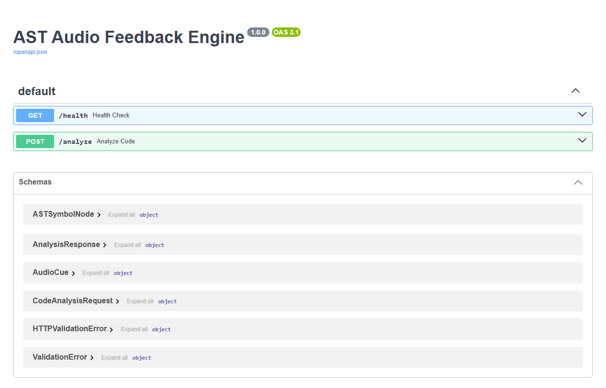
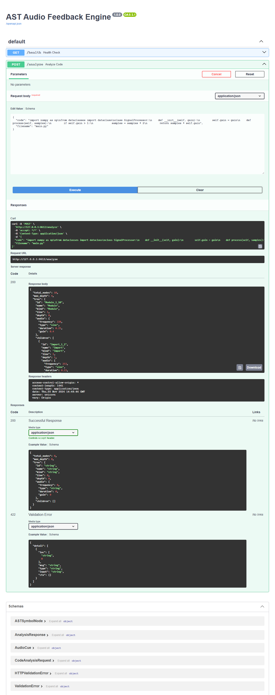
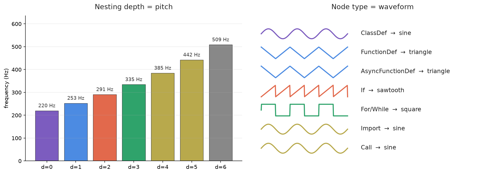

# 🎧 AST Audio Feedback Engine

Ever wanted to *hear* what your code looks like? That's exactly what this project does.

Feed it a snippet of Python and it parses the abstract syntax tree (AST), then turns every meaningful structure — classes, functions, loops, branches, imports — into a small audio cue. Nesting changes the pitch, the node type changes the waveform, and depth changes the duration and volume. The result is a JSON "score" that any frontend or Web Audio client can play back as a sonic map of your program.

Honestly, it started as a fun experiment, but it turns out this kind of thing is genuinely useful for accessibility — imagine hearing the shape of deeply nested logic instead of staring at indentation levels.

## Screenshots

The whole thing runs on FastAPI, so you get an interactive Swagger UI out of the box:



Sending some sample code to `/analyze` and getting back a playable audio tree:



## How the mapping works

Two simple rules drive all the sound:

- **Nesting depth → pitch.** Every level deeper multiplies the base note (A3, 220 Hz) by 1.15. Shallow code sounds low and calm; deep nesting climbs up the scale.
- **Node type → waveform.** Classes get a foundational sine tone, functions get a mellow triangle, `if` branches get a sharp sawtooth, and loops get a rhythmic square. Deeper nodes also play shorter and quieter, so busy regions of code don't turn into acoustic mush.



## The endpoints

| Method | Path       | What it does |
|--------|------------|--------------|
| GET    | `/health`  | Quick liveness check |
| POST   | `/analyze` | Turn Python source code into an audio map |
| GET    | `/docs`    | Interactive Swagger UI |

### Try it

Start the server:

```bash
pip install -r requirements.txt
uvicorn app.main:app --reload
```

Then send some code:

```bash
curl -X POST http://127.0.0.1:8000/analyze \
  -H "Content-Type: application/json" \
  -d '{
    "code": "import numpy as np\nclass SignalProcessor:\n    def process(self, samples):\n        if self.gain > 1:\n            return samples * 2\n        return samples * self.gain"
  }'
```

You'll get back something like this (trimmed for readability):

```json
{
  "total_nodes": 10,
  "max_depth": 4,
  "tree": {
    "id": "Module_1_10",
    "kind": "Module",
    "line": 1,
    "depth": 0,
    "audio": {
      "frequency": 220.0,
      "type": "sine",
      "duration": 0.25,
      "gain": 0.4
    },
    "children": [
      {
        "id": "Import_1_2",
        "kind": "Import",
        "depth": 1,
        "audio": { "frequency": 253.0, "type": "sine", "duration": 0.23, "gain": 0.37 },
        "children": []
      },
      {
        "id": "ClassDef_3_10",
        "name": "SignalProcessor",
        "kind": "ClassDef",
        "depth": 1,
        "audio": { "frequency": 253.0, "type": "sine", "duration": 0.23, "gain": 0.37 },
        "children": [
          {
            "id": "FunctionDef_6_10",
            "name": "process",
            "kind": "FunctionDef",
            "depth": 2,
            "audio": { "frequency": 290.95, "type": "triangle", "duration": 0.21, "gain": 0.34 },
            "children": [
              {
                "id": "If_7_9",
                "kind": "If",
                "depth": 3,
                "audio": { "frequency": 334.59, "type": "sawtooth", "duration": 0.19, "gain": 0.31 },
                "children": []
              }
            ]
          }
        ]
      }
    ]
  }
}
```

Every node carries its own `AudioCue` with `frequency`, waveform `type`, `duration`, and `gain` — so a frontend just walks the tree and triggers each cue. Play them in order, or in parallel with small delays, and the structure of your code literally becomes melody.

## How it's built

Not much to it, in a good way — the whole thing is three small files:

```
app/
├── main.py          # FastAPI routes: /health, /analyze
├── parser.py        # ASTAnalyzer: walks the AST with ast.NodeVisitor
├── audio_mapper.py  # The human part: depth → pitch, kind → waveform
└── schemas.py       # Pydantic models for the request, tree nodes, and audio cues
```

The parser keeps the tree clean by only visiting structural statement nodes (`FunctionDef`, `ClassDef`, `If`, `For`, `While`, `Import`, `Assign`, `Return`, `Call`), so you hear the *skeleton* of the program rather than every expression.

A few nice behaviors that come for free:

- **Syntax errors are friendly.** Instead of a stack trace, you get a clean 422 with the line number: `Syntax Error on line 7: invalid syntax`.
- **Empty code is handled.** Sending nothing meaningful gets a 400.
- **CORS is wide open** (`allow_origins=["*"]`) so any web client — say, a Web Audio visualizer — can call it straight from the browser.

## Project status

This is a working v1 prototype (told you — `1.0.0` in the API title). Ideas I'd like to explore next:

- A Web Audio frontend that animates the code while playing the cues
- A harmony mode where siblings play together as chords
- Support for other languages (JavaScript via a similar AST pass)
- Recording the output as WAV/MP3 so it can be shared as an audio file

## Requirements

Python 3.10+ with FastAPI, Uvicorn, and Pydantic (all listed in `requirements.txt`).
